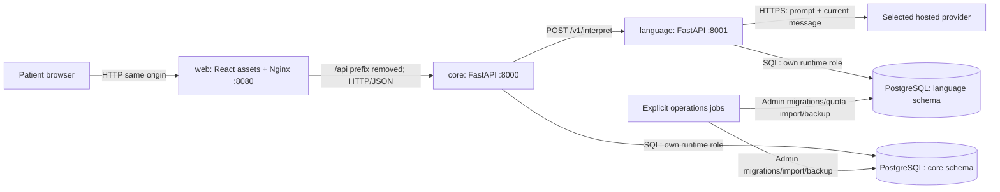
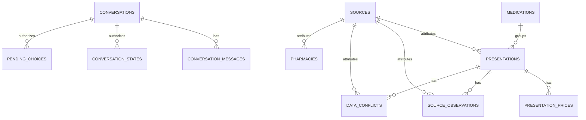
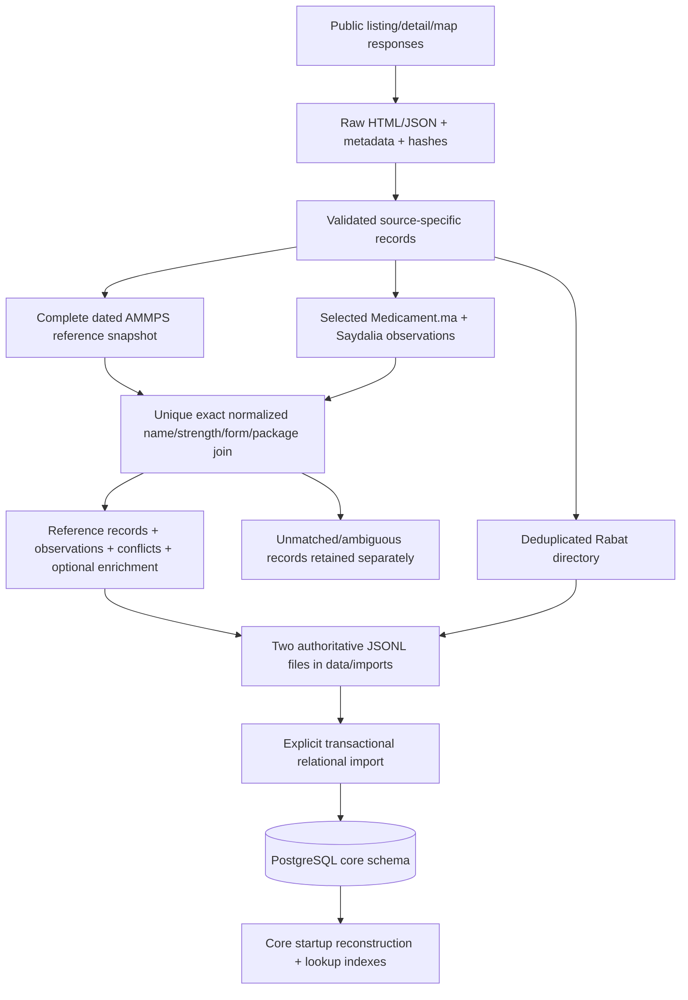

# Pharmacy Assistant — complete current project reference

Updated **2026-10-20**, after architecture migration, repository cleanup R1–R7,
and publication of commit `9eb046f` on `refactor/web-architecture`.
This document describes the implemented system, not a proposed redesign.
The documentation expansion itself is a later working-tree change.

An agent should read this file first, then consult only the implementation or
evidence relevant to its task. [DECISION_LOG.md](DECISION_LOG.md) records why the
user chose the improvements; its earlier “still open” statements are historical
and may be superseded by later decisions and the implementation described here.
Examples and commands in documentation are not authorization to execute them.

## Contents

1. [Purpose, scope and current status](#1-purpose-scope-and-current-status)
2. [Architecture and ownership](#2-architecture-and-ownership)
3. [Communication and API contracts](#3-communication-and-api-contracts)
4. [How a conversation works](#4-how-a-conversation-works)
5. [Matching, factual answers and pricing](#5-matching-factual-answers-and-pricing)
6. [PostgreSQL schema](#6-postgresql-schema)
7. [Data sources, collection and transformation](#7-data-sources-collection-and-transformation)
8. [Current repository structure](#8-current-repository-structure)
9. [Configuration, builds and operation](#9-configuration-builds-and-operation)
10. [Verification and evaluation evidence](#10-verification-and-evaluation-evidence)
11. [Rules for future work](#11-rules-for-future-work)

## 1. Purpose, scope and current status

This is a **local challenge demo and learning project** for Moroccan
patient–pharmacy requests. A patient types a question; hosted language extraction
identifies intent and literal entities; local Python code resolves recorded
medications/pharmacies, asks for clarification, calculates recorded-price totals
and constructs the answer. The model extracts information; it does not generate
the final factual answer or serve as the price database.

The patient interface is a responsive **French-only chat** with a healthcare
style, solid colors, no gradients and no decorative side strips on cards.
Backend interpretation and answer templates support French, Arabic, Darija and
mixed messages. A fully localized Arabic interface/RTL experience is deferred.

Implemented capabilities include:

- Medication identity, strength, form and presentation lookup; reviewed aliases,
  spelling suggestions, explicit refinement and presentation selection.
- Contextual follow-ups, medication-reference clarification and package totals.
- Recorded pharmacy names, contacts and addresses in a partial Rabat directory.
- Source links, collection dates, secondary observations and disagreements.
- Temporary server-persisted conversations, transcript restoration, reset,
  failed-message visibility and explicit retry/recovery.
- Independent services and containers, owned database schemas, shared inference
  quotas, explicit import/migrations/backup and budgeted evaluation tools.

It does **not** verify current stock, opening hours or pharmacy duty; rank
pharmacies by distance; diagnose symptoms; prescribe treatment; or determine
individual reimbursement eligibility. There are no accounts, durable patient
history, voice interface, local model training, vector database or embedding
retrieval pipeline. Intent recognition for an unsupported factual capability
does not mean that capability's data exists.

Architecture checkpoints D018 and cleanup checkpoints R1–R7 are complete.
Streamlit and the legacy `src/pharmacy_assistant` application are retired.
The user accepted the laptop demo; earlier laptop/phone review also passed.
For final R7, the user explicitly waived another physical-phone check after
suspecting campus Wi-Fi restrictions. Those restrictions were not confirmed;
automated mobile browser checks passed. The normal demo stack was subsequently
stopped at the user's request, preserving its database volume. This records the
last observed lifecycle event, not a live assertion about Docker state.

The cited related-work study and final submission/presentation remain separate
deliverables. A production-style code structure is implemented; public production
deployment, clinical validation and production readiness are not claimed.

## 2. Architecture and ownership

The runtime has **four normal containers**: web, core, language and PostgreSQL.
An additional operations image runs explicit administrative jobs only.



The two schema nodes are in **one PostgreSQL server and one database**, not two
independent database instances. A database/server outage affects both services.

| Component | Responsibility | Important boundary |
| --- | --- | --- |
| React/TypeScript frontend | Chat, transcript state, selection/refinement controls, medication/pharmacy cards, sources and recovery UI | Calls core through `/api`; no provider keys or SQL access; displays server-calculated amounts |
| Nginx in web image | Static frontend serving, same-origin reverse proxy, gateway failure response | Removes `/api` before forwarding; never automatically retries a request upstream |
| Core FastAPI | Conversation flow, context, medication matching, pharmacy lookup, pricing and templated answers | Calls language over HTTP; no provider SDK, peer implementation import or language-table access |
| Language FastAPI | Provider selection/adapters, extraction prompt, schema/span validation and attempt control | No catalogue/conversation access; no final factual answer generation |
| PostgreSQL `core` | Catalogue, provenance, aliases, directory and temporary conversations | Runtime role `pharmacy_core` restricted to its schema |
| PostgreSQL `language` | Attempt counters, spacing, cooldowns, evaluation budgets and import receipts | Runtime role `pharmacy_language` restricted to its schema |
| Contracts package | Pydantic interpretations, interpreter protocol, transport health/errors | No business rules, tables or provider implementation |
| Infrastructure package | Environment loading, SQL engine setup, workspace paths, migration helper and archive resolver | No domain logic or shared service-owned settings/tables |
| Operations/evaluation packages | Explicit administration, verification, scoring and controlled live evaluation | May depend on both services; neither service depends on these tools at runtime |

Python services run with Uvicorn. SQLAlchemy Core defines tables/queries and
transactions; psycopg is the PostgreSQL driver; Alembic owns migrations.
The frontend uses Vite, Tailwind, project-owned shadcn/ui components based on
Radix, Lucide icons and Zod response validation. npm and uv each have a lockfile.

### Runtime data access

Core loads its catalogue and pharmacy directory **from PostgreSQL at startup**
using `storage/postgres/catalogue.py`. It reconstructs validated public records,
then builds in-memory lookup indexes for deterministic matching. It does not run
SQL search for every medication phrase and does not load JSONL as a runtime
fallback. Catalogue changes therefore require an explicit data-update procedure
and a core restart to refresh that process's snapshot.

Conversation operations and language quota/budget operations use PostgreSQL
during requests. No database transaction remains open while waiting for hosted
inference: short transactions surround the external work. Missing/unavailable
PostgreSQL fails service startup/readiness clearly. Tests may explicitly inject
in-memory resources; no environment setting enables a file/SQLite runtime mode.

## 3. Communication and API contracts

### Network paths and exposure

The default browser entry point is `http://127.0.0.1:8080`. Docker's private
network resolves `core`, `language` and `postgres` by service name. Only web has a
host port in normal Compose. PostgreSQL listens internally on 5432; core on 8000;
language on 8001. Core's Compose language URL is `http://language:8001`.

Nginx forwards `/api/chat` to core `/chat`, `/api/conversation` to
`/conversation`, and similarly for the other core routes. Core's interactive API
documentation is reachable through `/api/docs`. Nginx resolves the core name
again after container replacement; it preserves application error bodies and
`Retry-After` rather than replacing them with generic errors.

| Owner | Method/path inside service | Purpose |
| --- | --- | --- |
| Web/Nginx | `GET /healthz` | Web serving health only |
| Core | `GET /health` | Catalogue counts/storage identity and language configuration/availability summary |
| Core | `GET /ready` | Own database readiness; language availability is deliberately not a readiness dependency |
| Core | `GET /medications/search` | Structured catalogue search filters |
| Core | `GET /medications/{record_id}` | One presentation by its preserved public source ID |
| Core | `POST /interpret` | Validated extraction through language; no factual retrieval/answer orchestration |
| Core | `POST /chat` | Text turn, offered record/refinement choice or offered context-reference choice |
| Core | `POST /conversation` | Create temporary conversation and issue opaque session token |
| Core | `GET /conversation` | Restore transcript/latest response using `Authorization: Bearer <session token>` |
| Core | `DELETE /conversation` | Invalidate/delete that conversation using its bearer token |
| Language | `GET /health` | Provider/model configuration and contract version; not proof a hosted request will succeed |
| Language | `GET /ready` | Configuration and own PostgreSQL quota-store readiness |
| Language | `POST /v1/interpret` | Internal version-1 extraction request/response contract |

There is no separate public pharmacy REST route: pharmacy retrieval is part of
chat orchestration. Language is normally internal to the Compose network.

### Extraction contract

`InterpretationRequest` contains only `text` (1–2,000 readable characters).
The provider receives the extraction instructions and **the current message**,
not the complete transcript or catalogue. Context inheritance happens in core
after extraction. There is no model training or full-catalogue upload step.

`InterpretationResponse` contains:

- `interpretation`: detected language, reply language/script, one or more intents,
  and extracted entities. A medication mention has nullable `name`, `strength`,
  `quantity`, `form` and `presentation`. Other entities include pharmacy, city,
  area, date, time and symptom. Up to ten medication mentions are accepted.
- `metadata`: provider, requested/returned model, output mode, prompt version,
  attempts, latency, completion ID and available token usage. Usage describes the
  successful attempt, not guaranteed billing totals across failures/retries.

Schemas forbid extra fields and apply strict types. Every non-null entity span
must occur in the current message after Unicode/whitespace normalization. Both
language and core check the evidence. This prevents invented extracted strings;
it does not prove that a present word was assigned the correct semantic label.

The maintained prompt version is `step9-package-selection-v1` in
`services/language/src/pharmacy_language/extraction/prompt.py`.
The selected demo setup is **Groq / `qwen/qwen3.8-27b` / `json_object`**, documented
in `.env.example`. Strict local validation still applies in JSON-object mode.
Provider-enforced `json_schema` is an explicit alternative, not an automatic
downgrade/upgrade. Gemini and OpenCode adapters remain available only through
explicit provider configuration. The bare inference settings class defaults to
Gemini; the demo template explicitly selects Groq. Preserve that distinction
when constructing settings in tools. No paid or cross-provider fallback exists.
These are repository configuration identifiers, not a claim about current
external model availability; private effective configuration is not reproduced here.

### Chat contract and generated frontend types

`ChatRequest` supports mutually checked request modes:

| Mode | Main fields |
| --- | --- |
| New text/follow-up | `text`, optional `session_id`, optional `request_id` |
| Offered context reference | `session_id`, `reference_index` |
| Offered record selection | `continuation_id`, `selections` containing mention index and record ID |
| Offered refinement/page | `continuation_id`, `refinements` containing mention index, field and offered value |

The browser creates a conversation first and assigns a unique `request_id` to
each submitted action. Its session token is carried in chat JSON; restore/reset
use the Authorization header. `continuation_id` authorizes saved clarification
state; it is not a substitute for an arbitrary record ID.

`ChatResponse` includes raw interpretation, effective/inherited context,
medication results/choices, optional pharmacy result, answer, sources, inference
metadata/`inference_performed`, session/continuation tokens and expiry, plus line
and order pricing. Results explicitly distinguish resolved/ambiguous/suggested/
not-found/filter-conflict states. Unknown stock/hours/duty are represented as such.

The reviewed core OpenAPI snapshot is `apps/web/contracts/core.openapi.json`.
`npm run types:api` generates `apps/web/src/shared/api/generated.ts` from it.
`shared/api/schema.ts` additionally validates received JSON at runtime using Zod;
TypeScript types alone do not validate HTTP responses. Contract changes require
updating the schema/snapshot/types/fixtures and relevant tests together.

### Timeouts and errors

The normal timeout ordering is provider attempt → language deadline → core HTTP
deadline (160 seconds) → Nginx read timeout (170) → browser chat timeout (175).
Language's deadline is twice the configured provider timeout plus 25 seconds.
Core makes **one HTTP attempt**; HTTPX does not transparently replay it.
The Groq adapter disables SDK retries and allows at most two controlled attempts
for eligible transient failures. Rate limits return cooldown information rather
than an immediate retry; invalid output is not silently replaced by a guess.

Known errors cross the service boundary as structured `detail` objects with a
machine code, safe message, retryability and optional retry delay. Representative
statuses are 422 invalid input, 409 conflicting/pending conversation action,
410 expired state, 429 quota/spacing, 502 invalid extraction, 503 unavailable
service/storage/configuration, and 504 timeout. `Retry-After` is preserved.
Remote free text/credentials are not forwarded as error messages.

## 4. How a conversation works

```mermaid
sequenceDiagram
    participant B as React browser
    participant C as Core through Nginx
    participant D as PostgreSQL core
    participant L as Language
    participant Q as PostgreSQL language
    participant P as Hosted provider
    B->>C: POST /conversation
    C->>D: Create expiring conversation + hashed token
    C-->>B: Opaque session token
    B->>C: POST /chat: text + session + request ID
    C->>D: Check token/revision/request; save pending turn; commit
    C->>L: POST /v1/interpret: current text
    L->>Q: Atomically reserve attempt/check cooldown; commit
    L->>P: Extraction prompt + current text
    P-->>L: Structured extraction
    L-->>C: Validated interpretation + metadata
    Note over C: Merge context; match loaded records; calculate; render answer
    C->>D: Atomically save answer/context/choices; advance revision/expiry
    C-->>B: Answer, cards, sources, choices, new tokens
```

For example, `Quel est le prix de ABIP ?` leaves multiple presentations. Core
asks the patient to select one rather than choosing a box silently. Clicking an
offered presentation sends its saved continuation token and record selection;
that turn reuses the validated interpretation **without hosted inference**.
`Et pour deux boîtes ?` is a new typed turn: language extracts that fragment,
then core can inherit the already selected medication and calculate its total.
ABIP boxes of 20 and 30 are distinct records (recorded prices 268 and 372 MAD).

### Persistent state around the local conversation engine

`PersistentChatService` in `storage/postgres/chat.py` wraps the deterministic
`conversation/service.py` engine. For each turn it obtains the persisted state,
constructs a local `ChatService`, decodes the saved state/choices, runs the turn,
and saves the result. Runtime persistence is therefore not the local engine's
process dictionaries. Its standalone 900-second default and old memory-only
docstring do not describe deployed retention: the wrapper passes **1,800 seconds**
and the database enforces the same 30-minute inactivity limit.

`conversation/state.py` separates literal current-message extraction from
inherited context. `context.effective_interpretation` records the usable merged
view; inherited fields are reported separately. When multiple prior medications
make a reference unclear, core offers an explicit reference choice. Candidate
record IDs and refinement values are checked against the choices actually saved
for that mention; a client cannot invent a new allowed selection.

### Tokens, revisions, transcript and request IDs

- Browser tab session storage keeps the opaque token, expiry and cooldown
  deadline, not transcript or request payloads. Undelivered text/UI state stays
  in page memory. PostgreSQL is authoritative for the transcript and current
  conversation. There is no account-based cross-device history.
- Session/continuation bearers are random URL-safe secrets. Only their SHA-256
  hashes are indexed in database tables. JSON state is versioned (`version: 1`),
  not Python pickle; stored public response payloads exclude bearer tokens.
- Each conversation has a revision and ordered message sequence. Transactions
  lock the parent conversation and validate revisions. Two concurrent turns may
  start from the same revision, but only a compatible completion can advance it;
  a conflict does not silently overwrite newer context.
- A request ID is unique within its conversation and is paired with a semantic
  request fingerprint. Same ID/different content is rejected. A known completed
  current-revision request can return saved output without another inference
  call; a pending request returns an explicit in-progress conflict. This is
  server-side duplicate protection, not an instruction to auto-retry POSTs.
- User turns are recorded as pending, answered or failed. Successful assistant
  turns and new context/choice state are committed together. Failures do not
  advance successful context or renew the inactivity expiry.

### Refresh, expiry, failure and reset

Successful turns renew expiry to 30 minutes from success. Refresh/GET restoration
does **not** renew expiry, replay text or invoke inference. It is read-only with
respect to conversation progression, but not literally a SQL-only read: it can
issue replacement hashed bearer tokens and mark pending turns older than three
minutes as `completion_unknown` failures. It returns the ordered transcript and
latest response with `inference_performed: false`.

Access rejects expired conversations immediately. A core background task runs
cleanup about every 60 seconds; deleting an expired/reset parent cascades through
its messages, state tokens and choices. Delayed cleanup during an outage does not
make expired state usable. Old revision tokens can restore the latest state while
the conversation is valid; stale tokens cannot advance outdated context.

The browser never automatically resends a POST. After an uncertain outcome it
restores status/transcript and requires explicit verification/retry. Failed text
remains visible. “Nouvelle conversation” first invalidates server state, then
clears local state; a failed reset does not pretend deletion succeeded.

### Failure boundaries

| Failure | Behavior |
| --- | --- |
| Language/provider unavailable or quota exhausted | New typed interpretation fails safely; valid saved offered choices and restore/reset can still work while core/database are available |
| Invalid model schema or unsupported entity evidence | Extraction rejected; no invented factual answer generated |
| Core unavailable | Gateway returns a structured safe 503; browser treats completion as potentially uncertain and does not replay |
| PostgreSQL unavailable | Required services fail startup/readiness or return storage/quota errors; no file fallback or untracked inference |
| Restart/replacement with same database volume | Catalogue, valid temporary state, transcript and quota counters survive within expiry |

## 5. Matching, factual answers and pricing

Medication lookup uses the startup catalogue's indexes and normalization helpers.
Exact normalized brand is prioritized, then exact active substance. Partial/fuzzy
candidates and reviewed aliases aid discovery, but uncertain identities require
confirmation. Stated strength, form and presentation are checked independently;
conflicting filters are shown rather than silently discarded. Broad results are
refined by strength/form/brand/presentation and paginated in bounded previews
(up to five record choices at once). Name, dose and package normalization support
reviewed French/Arabic/Darija forms; this is application logic, not vector search.

Runtime tolerant search is distinct from the **strict historical cross-source
data join** described below. A spelling suggestion in chat does not authorize
merging two database source records.

Pharmacy search normalizes names/aliases and area/address terms. City defaults
explicitly to Rabat; other cities return outside-coverage. Results are sorted by
name, limited to five per response with total/truncation metadata, and never
presented as nearest-by-distance. Matching a pharmacy does not establish stock,
opening hours or dated duty.

`conversation/answers.py` renders deterministic language/script-aware templates
from the interpretation and retrieved records. The frontend displays the answer
and structured cards, not raw extraction JSON. AMMPS and linked secondary source
URLs/timestamps are deduplicated into the response's sources.

`medications/pricing.py` parses explicit **whole-presentation counts** using a
reviewed number/unit grammar, including French/Arabic/Darija forms. Counts must
be positive and bounded (maximum 1,000). It never assumes a missing quantity,
converts doses or prices individual tablets from a box. A specific flacon/tube
request is accepted only when that container matches the selected presentation.
Arithmetic uses `Decimal`, two decimals and `ROUND_HALF_UP`; API totals are decimal
strings in MAD. Missing price is unknown, not zero. An order total is published
only when all requested lines can be calculated; otherwise it is incomplete.

## 6. PostgreSQL schema

The normal database is `pharmacy_assistant` on PostgreSQL 17. SQL tables are
defined in each service's `storage/postgres/models.py`; frozen DDL lives in its
`migrations/versions/0001_initial.py`. Current revisions are **`core_0001`** and
**`language_0001`**. Each schema also has its own `alembic_version` table.
The migration helper creates the schemas explicitly; service startup never
migrates, grants permissions or imports records.

Administrative credentials (`pharmacy_admin` in the generated setup) handle DDL,
grants and imports. Runtime `pharmacy_core` and `pharmacy_language` roles receive
usage/DML/sequence permissions for their own service's tables and no access to
the peer schema; they do not receive migration credentials. Service ownership is
logical responsibility and permission isolation, not a claim that runtime roles
own the SQL DDL. There are no cross-schema foreign keys or shared domain tables.

### Relationships



These entities are in `core`. `medication_aliases` and `import_runs` are standalone
core tables. The three language tables are standalone too; evaluation IDs and
quota scopes are logical grouping keys, not foreign keys into core.

### Core catalogue and provenance tables

`PK` means primary key; `FK` means foreign key. Unless identified as optional,
columns are required. Text metadata remains text rather than being interpreted
as a current clinical fact.

| Table | Columns and relationships |
| --- | --- |
| `core.sources` | `id TEXT PK`; imported IDs are `AMMPS`, `medicament.ma`, `saydalia.ma` |
| `core.medications` | `id BIGINT PK`; required `brand_name`, `active_substance`, `epi`, `dosage`, `form`; exact five-field tuple is unique, nonblank and uses `C` collation; indexes on brand/substance |
| `core.presentations` | `source_record_id TEXT PK` preserving the original numeric AMMPS ID; `medication_id FK → medications.id`; `source FK → sources.id`; required `presentation`, `commercialization_status`, positive `source_page`, `source_url`, unique `source_order`; optional `authorization_status`, `therapeutic_class`, `pp_gn_raw`, `vat_raw`, `rcp_naf_reference`, `detailed_source_url`, `source_fetched_at_utc`, parsed `fetched_at TIMESTAMPTZ`, `atc_code`, `reimbursement_status` (`yes`/`no`/null). Source constrained to AMMPS |
| `core.presentation_prices` | Composite PK `(presentation_id, kind)`; `presentation_id FK → presentations.source_record_id ON DELETE CASCADE`; `kind` is `ppv`, `hospital` or `pfht`; optional `amount NUMERIC(12,2)`. Import writes all three kinds per presentation, including null amounts |
| `core.source_observations` | Composite PK `(presentation_id, position)`; presentation FK with cascade; source FK restricted to the two secondary sources; required `source_record_id`, `source_url`, original `fetched_at_utc` and parsed `fetched_at`; optional `source_updated_at_raw`, `atc_code`, `reimbursement_raw`, `commercialization_status`, `ppv_price_mad`, `hospital_price_mad`; unique `(presentation_id, source, source_record_id, fetched_at_utc)` |
| `core.data_conflicts` | Composite PK `(presentation_id, position)`; presentation FK with cascade and secondary-source FK; `field`, `reference_value JSONB`, `observed_value JSONB`, `source_url`. Values are constrained to JSON scalar/null rather than arbitrary nested objects; position preserves record order |
| `core.medication_aliases` | `spelling TEXT PK`, indexed `normalized_key`, `target TEXT`, `requires_confirmation BOOLEAN`. Target is a reviewed textual name, not a medication FK; importer/reconstruction check equality with the code's reviewed aliases |
| `core.pharmacies` | `pharmacy_id TEXT PK` (`saydalia:<digits>`), indexed `name`, `city` constrained to Rabat, optional `address`/`phone`/`opening_information`, required `latitude`/`longitude FLOAT(53)` with coordinate bounds, source FK, `source_url`, `source_request_url`, original `fetched_at_utc`, parsed `fetched_at`, `directory_scope`, unique `source_order` |
| `core.import_runs` | `id TEXT PK` is import signature; `importer_version`, `inputs JSONB` with source paths/hashes, `counts JSONB`, `completed_at TIMESTAMPTZ`; receipt supports safe repeat checks |

All stored money columns reject negative, infinite and NaN amounts; null remains
allowed for unknown prices. Source order reconstructs the original JSONL order.
Nullable timestamps retain the corresponding original source timestamp string.
`rcp_naf_reference` retains a source reference/URL; it is not parsed document text.

### Core temporary-conversation tables

| Table | Columns and relationships |
| --- | --- |
| `core.conversations` | `id UUID PK`, `created_at`, optional `last_success_at`, indexed `expires_at` (TIMESTAMPTZ), nonnegative `revision BIGINT`, nonnegative `next_sequence BIGINT`; expiry cannot precede creation |
| `core.conversation_messages` | `id UUID PK`, indexed `conversation_id FK → conversations.id ON DELETE CASCADE`, `sequence BIGINT`, `role` (`user`/`assistant`), `outcome` (`pending`/`answered`/`failed`), optional `text`, `created_at`, optional `request_key`, `request_fingerprint`, `payload JSONB`; unique `(conversation_id, sequence)` and `(conversation_id, request_key)` |
| `core.conversation_states` | `token_hash TEXT PK` (64-character SHA-256), indexed cascading conversation FK, `revision BIGINT`, versioned `payload JSONB`, `created_at`; stores context/latest response associated with session token |
| `core.pending_choices` | Same key/parent/revision/time shape as conversation states; versioned `payload JSONB` stores interpretation, results, allowed resolution state and context for an offered continuation |

JSONB is used deliberately for versioned temporary state, variable message
payloads, import receipts and scalar conflicts; the catalogue and relationships
are relational. This is not a JSONL document dump or a MongoDB-style runtime.

### Language quota/evaluation tables

| Table | Columns and behavior |
| --- | --- |
| `language.quota_state` | `scope TEXT PK`, `next_at`, `blocked_until` (TIMESTAMPTZ), optional `block_code`, nonnegative `attempts BIGINT`; scope combines configured scope, provider and model |
| `language.evaluation_budgets` | `id TEXT PK`, indexed `evaluation_id`, `maximum BIGINT`, `used BIGINT`; constraint `0 ≤ used ≤ maximum`; one invocation budget can contribute to a larger evaluation's total |
| `language.quota_imports` | `input_hash TEXT PK`, `source_path`, `imported_at`; receipt for explicit legacy SQLite ledger import |

Before every actual provider attempt, a transaction checks/locks the optional
evaluation budget and quota scope, checks cooldown/spacing, increments attempts
and budget usage, and commits. Failed/uncertain attempts remain reserved. This
coordinates processes and survives restart; it does not promise exact provider
billing reconciliation. Cooldowns never shorten an existing later deadline.
The quota tables contain counters/timestamps/identifiers, not patient text,
prompts, answers or API keys. A quota-store failure blocks new inference.
Legacy SQLite is supported only as an explicit read-only import source; no
running service selects it as its quota backend.

## 7. Data sources, collection and transformation

### Sources and accepted scope

These are **dated collected observations**, not live offers or current coverage
claims. No source is visited during a normal chat. Collection/enrichment code was
retired after its outputs, provenance and useful checks were preserved.

| Source | Collection and role | Accepted result |
| --- | --- | --- |
| AMMPS public medication listing | Saved pages from `https://www.ammps.gov.ma/basesdedonnes/liste_marocaine_des_medicaments?page=…`; reference identities, presentations, prices/status and available reference links | Fresh 2026-10-18 snapshot: 497 pages, 9,936 unique source presentations; complete against that dated advertised total, not a universal coverage guarantee |
| Medicament.ma | Public A–Z/listing discovery and medication detail pages; secondary price/status, ATC and reimbursement observations | 988 verified newly collected details plus 20 earlier IDs not refreshed = 1,008 selected observations; collection intentionally stopped before exhausting 5,036 discovered current detail URLs |
| Saydalia medication listing | Public paginated medication cards, parsed once per source ID despite duplicate desktop/mobile attributes | All 442 advertised listing pages at cutoff, 5,299 selected observations; not a claim of complete national coverage |
| Saydalia Rabat pharmacy map | Systematic grid of map origins using normal public map-result requests; source example `https://saydalia.ma/api/siteweb_api.php?origin=33.970000%2C-6.940000&limit=35` | 327 unique Rabat pharmacy IDs collected 2026-10-19, retaining the earlier 115; partial directory, not proof of complete city coverage |

Historical collection used sequential requests, minimum two-second spacing,
bounded retries, raw-response caching, UTC fetch metadata and SHA-256 integrity
checks. Source restrictions/errors and gaps were recorded; restrictions were not
bypassed. Fresh AMMPS pagination was kept separate from older caches whose totals
differed. Page totals, expected rows and uniqueness were validated before use.
Map configuration tokens were excluded from stored request metadata; collection
did not call Google Maps APIs. Attribution does not establish a blanket license
over third-party material.

A typical saved page has `page_N.html` (response), `page_N.meta.json` (retrieval
metadata/integrity) and `page_N.json` (parsed records). Raw source artifacts and
older datasets are evidence, not the application's runtime database. Some original
downloads were always ignored/local and are not available from a Git clone.

### Transformation pipeline



1. **Parse and validate.** Normalize source encodings, field/price representations
   and known missing markers. Price markers such as `NA`/`SANS …` become null,
   never zero; unrecognized price formats fail validation. Preserve original
   source IDs, page/URL, timestamps and available raw/reference fields. Available
   RCP/NAF links were recovered; their document contents were not interpreted.
2. **Freeze the accepted collection cutoff.** For each secondary source ID, choose
   the latest complete observation as a whole. Retain earlier IDs not refreshed;
   do not fill null fields in a new observation from an older snapshot. Verify
   saved raw hashes and parsed outputs before using the candidate.
3. **Reconcile conservatively.** Normalize brand, dosage/units, form and package
   signature. Link only when the full signature identifies exactly one official
   presentation. Package sizes/volumes stay significant. Missing signatures,
   supplements/devices, unmatched or ambiguous products are not auto-merged.
   There is no fuzzy cross-source auto-join.
4. **Preserve reference facts and disagreements.** AMMPS prices and commercialization
   statuses remain canonical. Secondary values are attached as source observations;
   differences produce explicit conflicts rather than overwrite the reference.
   Valid consistent observed ATC codes may populate `atc_code`; recognized consistent
   `oui`/`non` reimbursement values become `yes`/`no`. Conflicting canonical
   enrichment stays unknown while observations remain inspectable. ATC values
   are syntactically screened, not independently clinically verified.
5. **Prepare the pharmacy directory.** Deduplicate by source pharmacy ID, retain
   coordinates/contact provenance and Rabat scope; leave missing addresses null.
   Phone-format validation is not a reachability check. Undated duty markers are
   preserved separately as unverified evidence, not promoted into current duty.
6. **Validate and activate.** The expanded candidate passed catalogue/official-fact
   preservation and backend checks, then was activated with user approval on
   2026-10-19. Previous active inputs were backed up with hashes. Activation did
   not require hosted inference.
7. **Relocate without changing bytes.** Cleanup moved the two authoritative JSONL
   inputs from `data/processed/` to `data/imports/`; public raw/secondary/historical
   evidence moved into a hash-verified archive. Runtime migration imported the
   same facts into related PostgreSQL tables.

### Current input facts and hashes

| Measure | Current value |
| --- | ---: |
| Official presentations | 9,936 |
| Exact medication identity groups | 7,302 |
| Presentations with linked secondary observations | 2,700 |
| Linked observations | 3,128: 482 Medicament.ma + 2,646 Saydalia |
| Selected secondary observations retained in historical datasets | 6,307: 1,008 + 5,299 |
| Unmatched secondary observations retained separately | 3,179 |
| Canonical sourced ATC values | 2,662 presentations |
| Canonical sourced reimbursement values | 1,979 presentations |
| Actual per-presentation conflict entries | 1,260: 701 status, 540 public-price, 15 hospital-price, 4 ATC |
| Missing public prices | 1,126 presentations |
| Pharmacies | 327; 11 missing addresses; no verified current hours/duty/stock |
| Reviewed medication alias spellings imported | 22 (17 distinct normalized keys) |

Secondary counts overlap the AMMPS catalogue; they are not additional unique
medications to add to 9,936. Older candidate summaries count 1,258 conflict events;
the actual input contains 1,260 per-observation conflict entries, including four
entries for ATC disagreements. The schema/profile/import count uses the actual
entries. Historical summaries are retained unchanged, not silently rewritten.

Authoritative input SHA-256 values:

```text
data/imports/ammps_medications_enriched.jsonl
00cfe355403a12360d108bd5d2d9673f44599c51af592245e229b2827681bb0b

data/imports/pharmacies_rabat.jsonl
e64af06edd1d3116732196dbe010b61d82c5c4e4ce8c345db22f22f5add233b8
```

### Relational import and lossless reconstruction

`services/core/src/pharmacy_core/storage/postgres/catalogue.py` implements importer
`relational-v1`. Pydantic first validates the inputs. It groups identities using
the exact source tuple `(brand_name, active_substance, epi, dosage, form)`;
this grouping is not the more tolerant runtime search normalization. Every
presentation retains its original public source ID, original ordering and facts.
It inserts three price rows per presentation (29,808 total, including nulls),
ordered secondary observations/conflicts, reviewed aliases and pharmacy rows.

Import is one transaction protected by an advisory lock. An import signature
hashes importer version, input hashes and reviewed aliases. Repeating the same
import reconstructs and compares the stored data before reporting it repeated.
Different existing data is refused; import does not overwrite a populated
catalogue or reset the database. Price conversion rejects loss of precision,
negative/nonfinite values and values outside `NUMERIC(12,2)` capacity.

Before committing, reconstruction must reproduce **every medication and pharmacy
record**, including optional values, prices, source metadata, conflicts and order.
Failure rolls back the transaction. An `import_runs` receipt records input hashes
and counts. Runtime startup uses the same reconstruction, including a check that
stored aliases match the reviewed code version. No scraping/LLM inference occurs
in this import or reconstruction.

### Where the evidence lives now

| Location | Meaning |
| --- | --- |
| `data/imports/` | Two authoritative setup/import inputs, not runtime fallback storage |
| `data/evaluation/` | Active smoke annotations, 80-case development/held-out split/manifests and later matching regressions |
| `archive/historical/data/` | Byte-preserved tracked snapshots, earlier secondary datasets and other historical data |
| `archive/historical/reports/` | Original collection/candidate/activation/quality/evaluation reports |
| `archive/historical/docs/` | Superseded process notes; old command/path examples are historical |
| `archive/manifest.json` | 1,002 historical relocations plus two active input relocations, with exact hashes/original Git identities |
| `archive/local/` | Ignored private preservation of 6,433 previously ignored raw/staging files with a separate local manifest; not included in Git or the public archive manifest |
| `artifacts/` | Ignored current generated reports/logs/screenshots/builds; not immutable historical evidence |

The maintained archive resolver maps old input paths through the public manifest
and verifies hashes; historical report paths/content need not be rewritten.
`pharmacy-archive` checks all 1,004 public mappings. New evaluation fingerprints
refer to current code/data; old freezes cannot authorize a current live run.

Key lineage evidence: `archive/historical/docs/data-checkpoint.md`,
`collection-expansion.md`, `demo-enrichment-cutoff.md`;
`archive/historical/reports/demo_enrichment_candidate.json`,
`demo_enrichment_activation.json`, `architecture_checkpoint2_data_profile.json`.
Retired collectors/preparation code can be inspected in Git history at the
pre-cleanup commit `b1bca16`; those old modules are not installed current commands.

## 8. Current repository structure

This is the maintained structure by responsibility, including the important
implementation leaves. Repetitive tests, individual archived pages and generated
dependencies are summarized so the map remains useful. Python `__init__.py`
markers and routine build-config files are not individually expanded everywhere.

```text
pharmacy-assistant/
├── PROJECT_CONTEXT.md                 # this self-contained system reference
├── DECISION_LOG.md                    # finalized improvement choices/rationale
├── README.md                         # public introduction and navigation
├── pyproject.toml                    # virtual uv coordinator, not an app package
├── uv.lock                           # one Python workspace lockfile
├── .env.example                      # placeholders + documented provider setup
├── .gitignore, .gitattributes, .dockerignore, .python-version
├── apps/
│   └── web/
│       ├── Dockerfile, package.json, package-lock.json, README.md
│       ├── index.html, vite.config.ts, playwright.config.ts
│       ├── tsconfig*.json, components.json, .oxlintrc.json
│       ├── public/favicon.svg
│       ├── contracts/core.openapi.json
│       ├── src/
│       │   ├── app/App.tsx, main.tsx, styles/
│       │   ├── features/
│       │   │   ├── chat/components/chat.tsx
│       │   │   ├── chat/state/conversation.ts
│       │   │   └── results/
│       │   │       ├── components/    # cards, clarification, results, sources
│       │   │       ├── lib/presentation.ts
│       │   │       └── types.ts
│       │   └── shared/
│       │       ├── api/client.ts, schema.ts, generated.ts
│       │       ├── ui/                # project-owned UI controls
│       │       └── lib/utils.ts
│       └── tests/browser/, fixtures/, support/
├── services/
│   ├── core/
│   │   ├── pyproject.toml, Dockerfile, alembic.ini
│   │   ├── migrations/env.py, script.py.mako, versions/0001_initial.py
│   │   ├── src/pharmacy_core/
│   │   │   ├── config.py
│   │   │   ├── api/app.py, dependencies.py, resources.py
│   │   │   ├── api/routes/catalogue.py, chat.py, conversations.py, health.py
│   │   │   ├── clients/language.py
│   │   │   ├── conversation/answers.py, errors.py, models.py, service.py, state.py
│   │   │   ├── medications/catalog.py, matching.py, models.py, normalization.py, pricing.py
│   │   │   ├── pharmacies/directory.py, models.py, normalization.py
│   │   │   └── storage/postgres/
│   │   │       └── models.py, catalogue.py, chat.py, conversations.py, state_codec.py
│   │   └── tests/unit/, integration/
│   └── language/
│       ├── pyproject.toml, Dockerfile, alembic.ini
│       ├── migrations/env.py, script.py.mako, versions/0001_initial.py
│       ├── src/pharmacy_language/
│       │   ├── config.py
│       │   ├── api/app.py
│       │   ├── extraction/prompt.py, service.py, validation.py
│       │   ├── providers/groq.py, gemini.py, opencode.py
│       │   ├── quota/control.py
│       │   └── storage/postgres/models.py, quota.py
│       └── tests/unit/
├── packages/
│   ├── contracts/
│   │   ├── pyproject.toml
│   │   ├── src/pharmacy_contracts/errors.py, interpretation.py, interpreter.py, language.py
│   │   └── tests/
│   └── infrastructure/
│       ├── pyproject.toml
│       ├── src/pharmacy_infrastructure/
│       │   └── database.py, environment.py, evidence.py, migrations.py, paths.py
│       └── tests/
├── tools/
│   ├── operations/
│   │   ├── pyproject.toml, Dockerfile
│   │   ├── src/pharmacy_ops/
│   │   │   ├── database.py, migrations.py, import_validation.py, backup.py
│   │   │   ├── compose_setup.py, compose_verify.py, postgres_checks.py
│   │   │   └── checks.py, archive.py, quota.py, export_contract.py, fixtures.py
│   │   └── tests/
│   └── evaluation/
│       ├── pyproject.toml
│       ├── src/pharmacy_evaluation/
│       │   ├── cli.py, config.py, ledger.py
│       │   ├── datasets/baseline.py
│       │   ├── scoring/extraction.py
│       │   ├── runners/baseline.py, development.py, held_out.py, interpretation.py
│       │   ├── runners/scenarios/conversation.py, pharmacy.py
│       │   └── reporting/analysis.py, freeze.py, io.py, merge.py, state.py
│       └── tests/
├── deploy/
│   ├── compose.yaml                   # four normal services + tools-profile job
│   ├── compose.phone.yaml             # opt-in web-only Wi-Fi exposure
│   ├── compose.debug.yaml             # opt-in localhost backend/database ports
│   └── nginx/nginx.conf
├── data/
│   ├── imports/ammps_medications_enriched.jsonl, pharmacies_rabat.jsonl
│   └── evaluation/
│       ├── interpretation_smoke.json
│       ├── baseline_v1/development.json, held_out.json, manifest.json
│       └── matching_regressions_v1.json, matching_regressions_v1_manifest.json
├── tests/
│   ├── __init__.py
│   ├── architecture/                  # package/config/boundary/retirement checks
│   ├── integration/                   # transport, PostgreSQL, contracts, evidence
│   └── support/                       # explicit fakes, fixtures and DB harness
├── docs/
│   ├── architecture/overview.md
│   ├── development/cleanup-plan.md, evaluation-tools.md
│   ├── operations/setup.md, tooling.md
│   ├── project/data-and-evidence.md, requirements-audit.md, demo-guide.md
│   └── validation/                    # R1–R7 guides, manifests and test reports
├── archive/
│   ├── README.md, manifest.json
│   ├── historical/                    # tracked original data/reports/docs
│   └── local/                         # ignored preserved private raw/staging data
├── artifacts/                         # ignored generated output/evidence/builds
├── .runtime/                          # ignored credentials/runtime ledgers/backups
├── .env                               # ignored local provider/environment settings
├── .venv/                             # ignored local Python workspace environment
└── .vscode/                           # ignored local editor settings, when present
```

There is no active root `src/`, `migrations/`, `reports/`, `tmp/` or `.streamlit/`.
There is no legacy compatibility package or scraping launcher. Generated
`node_modules/`, `dist/` and caches may exist locally but are not maintained source.
The old root `HOW_IT_WORKS.md` and architecture text are historical/archive
documents; this file describes their current replacement architecture.

Six installable Python members are `pharmacy-core`, `pharmacy-language`,
`pharmacy-contracts`, `pharmacy-infrastructure`, `pharmacy-ops` and
`pharmacy-evaluation`. Each has its own manifest, source namespace and tests.
uv coordinates them with one lockfile; independent installed packages/images
must not rely on importing another member's uninstalled source tree.

## 9. Configuration, builds and operation

Python requires 3.12+. Current build/test tooling uses uv 0.11.19 and Node
22.23.2/npm; precise dependencies are in `uv.lock` and
`apps/web/package-lock.json`. PostgreSQL is version 17. `STORAGE_BACKEND` accepts
only `postgres` in running service settings.

| Configuration | Role |
| --- | --- |
| `.env.example` | Public placeholders/settings example; no actual secrets |
| `.env` | Ignored local provider selection/key/settings; never publish/read out keys |
| `.runtime/postgres.env` | Ignored host/admin/runtime DB credentials created explicitly |
| `.runtime/compose.env` | Ignored Compose-ready settings, including internal database addresses/provider settings |
| `CORE_DATABASE_URL` | Core-owned PostgreSQL URL; core does not retain provider or language DB credentials |
| `LANGUAGE_DATABASE_URL` | Language-owned PostgreSQL URL and quota storage |
| `MIGRATION_DATABASE_URL` | Administrative URL for explicit jobs, not normal service environment |
| `LANGUAGE_SERVICE_URL`, `LANGUAGE_SERVICE_TIMEOUT_SECONDS` | Core's language HTTP origin/deadline |
| `INFERENCE_PROVIDER`, provider-specific model/key/output/timeout settings | Explicit language adapter/configuration |
| `INFERENCE_QUOTA_SCOPE`, `INFERENCE_MIN_INTERVAL_SECONDS` | Shared attempt scope/optional local spacing; zero spacing does not disable provider limits |

Database engines use pre-ping, bounded pools, a five-second connection timeout,
ten-second SQL statement timeout, three-second lock timeout and UTC sessions.
SQL parameter hiding and sanitized errors reduce accidental secret exposure.
Bearer tokens authorize temporary conversations; this is not account authentication.
There is no configured public TLS/authentication/deployment layer. Never expose
the internal services/database publicly just to access the web interface.

`pharmacy-compose-setup` creates the Compose environment from existing private
settings and database credentials; it refuses to overwrite existing output.
`pharmacy-db init-env` similarly creates new credentials exclusively. Do not rerun
credential generation as a routine fix for an existing volume/configuration.
Normal source/config updates do not automatically regenerate built images or
the copied Compose environment; use the explicit documented update procedure.

### Startup versus administration

Fresh setup proceeds explicitly: prepare environment → generate credentials and
Compose configuration → build images → start PostgreSQL → migrate schemas →
grant runtime permissions → import JSONL → verify reconstruction/permissions →
start the normal application. The exact runnable commands are in
`docs/operations/setup.md`; existing installations reuse their credentials/data.

The normal Compose project name is `pharmacy-assistant-architecture`. Its named
volume is `pharmacy-assistant-architecture_postgres_data`; never change that
identity or pass `--volumes` casually. Default restart policy is `no`, so containers
do not promise automatic recovery. Python/web containers use read-only filesystems,
temporary writable `/tmp`, dropped capabilities and no-new-privileges settings.
Multi-stage images contain installed packages or built frontend assets rather
than requiring the development checkout. The operations image includes owned
migrations and the two import inputs for explicit jobs.

For the **user to run** in an already configured workspace:

```powershell
# Start the configured demo; does not migrate/import.
docker compose --env-file .runtime/compose.env -f deploy/compose.yaml up -d --wait

# Stop/remove containers and network, preserving the database volume.
docker compose --env-file .runtime/compose.env -f deploy/compose.yaml down
```

The phone overlay binds only web to a chosen Wi-Fi IP; it leaves core/language/
database internal. Campus/client-isolated Wi-Fi may prevent device-to-device
access. The debug overlay publishes database/core/language on **localhost only**
(55432/18000/18001). Neither overlay is enabled by normal startup.

### Maintained commands

| Entry point | Purpose |
| --- | --- |
| `pharmacy-db` | `init-env`, `migrate`, `grant`, `import`, `verify`, explicit `import-quota` |
| `pharmacy-backup` | Explicit backup/restore workflows; private output |
| `pharmacy-compose-setup` | Compose environment preparation without service startup |
| `pharmacy-compose-verify` | Explicit isolated deployment/browser/PostgreSQL verification and owned cleanup |
| `pharmacy-export-contract` | Core OpenAPI export without hosted inference |
| `pharmacy-fixtures` | Deterministic frontend fixtures |
| `pharmacy-quota` | Inspect maintained quota state |
| `pharmacy-check` | Discover/run owned Python test groups |
| `pharmacy-archive` | Verify public preservation mappings/hashes |
| `pharmacy-evaluate` | Offline scoring and explicitly budgeted live evaluation/freeze/resume tools |

`pharmacy-backup` uses PostgreSQL 17 `pg_dump`/`pg_restore` client tools. Its
custom-format backup retains catalogue/directory and language accounting data,
but explicitly excludes rows from all four temporary-conversation tables. The
`verify` action restores into a newly created temporary database, compares
catalogue/directory/quota/budget/import data, checks temporary history is absent,
then removes that verification database. It does not overwrite the application
database. Backup preservation and named-volume persistence are different:
restarting containers keeps unexpired conversations in the volume; these backups
intentionally do not retain their contents.

Use `docs/operations/tooling.md` and `docs/development/evaluation-tools.md` for
arguments and backup/live-budget procedures. Generated reports belong in
`artifacts/`; protected historical data/report/archive paths must not be overwritten.

## 10. Verification and evaluation evidence

R7 verified a clean export of 1,290 then-publishable files from the uncommitted
working tree, not a remote clone. The validated changes were subsequently
committed/pushed as `9eb046f`; final whitespace-only EOF cleanup preceded that
commit. This reference expansion is documentation work after that checkpoint.

| Verification gate | Result recorded in R7 |
| --- | --- |
| Frozen noneditable independent package installs | All six members passed outside the original source tree |
| Offline Python | 247 passed; 18 PostgreSQL tests intentionally skipped offline |
| Offline browser | 22 passed, including mobile layouts; one deployment-only skip covered by real-stack check |
| Full isolated deployment | All ten aggregated stack scenarios passed |
| Real PostgreSQL | All 18 tests passed, zero skips |
| Builds | Six wheels/source distributions, fresh frontend dependency install/build, all four production image builds and installed-image checks passed |
| Contracts, archives, fixtures | Original OpenAPI/types preserved, all 1,004 archive mappings verified, deterministic fixture checks passed |
| Lint | Zero errors; two preexisting shadcn hot-refresh warnings |
| Manual acceptance | Laptop passed; final physical-phone repeat explicitly waived |

The isolated verifier covers explicit/repeated migration/import, full catalogue/
directory round trip, permissions, quota concurrency/cooldowns/budgets/resume,
backup/restore, language/core outages, DNS recovery, inference-free choices,
transcript/refresh/reset and database/whole-stack replacement with persistent data.
It uses its own temporary stack/database/volume and removes them; application
data is not modified. No automated hosted inference occurred. Disposable clean
exports/environments and temporary containers were removed; compact reports,
screenshots/logs/builds remain under ignored `artifacts/cleanup/r7/`.

Current engineering evidence: `docs/validation/cleanup-r7.md`,
`cleanup-r7-baseline.json`, `cleanup-r7-container.json`, `cleanup-r7-installs.json`,
`cleanup-r7-images.json`, `cleanup-r7-commands.json`, `cleanup-r7-user-review.json`
and `cleanup-r7-temporary-cleanup.json`. R1–R6 JSON remains frozen evidence of
those checkpoints; old paths/statuses in those reports are not current instructions.

Maintained offline checks for the user/authorized agent:

```powershell
uv sync --frozen
.\.venv\Scripts\pharmacy-check.exe
.\.venv\Scripts\pharmacy-archive.exe

# From apps/web:
npm ci
npm run build
npm run lint
npm test
```

Playwright uses installed Edge by default on Windows and closes its temporary
test server. Real PostgreSQL checks are skipped without their explicit isolated
environment. The full lifecycle command, **for the user to run**, is:

```powershell
.\.venv\Scripts\pharmacy-compose-verify.exe --run-isolated --frontend
```

### Model accuracy is a separate kind of evidence

The 80-case synthetic annotated dataset has separate development/held-out files.
Historical frozen held-out results were 34/40 backend cases, intent F1 92.86%,
entity-slot F1 95.91%, and 48/48 schema-valid completions. A later correction run
reported 14/14 backend cases, 20/20 schema-valid completions and raw slot F1 85.71%;
it included seen failures/development variations, not a new independent benchmark.
The 40-case deterministic oracle used in cleanup tests local behavior against
annotated extraction; it does not remeasure the hosted model.

Those results belong to their original frozen/development versions. Synthetic
annotations were assistant-authored/reviewed; independent native-speaker/clinical
review and population-wide accuracy are not claimed. Evaluation tools preserve
recorded outputs, budgets, fingerprints and resume protection. Changing code/data
does not silently validate an old freeze for a new live run. New live evaluations
require explicit authorization/budgets, not just a passing offline score.

## 11. Rules for future work

- **Give the user commands to start/stop application containers and isolated
  stacks; do not execute those lifecycle commands yourself.** This is the user's
  latest explicit preference, even when they discuss a startup/shutdown task.
- Do not run hosted inference, restart collection/scraping, change network/DNS,
  regenerate credentials, change private ledgers or reset/delete application
  volumes without specific authorization. Do not print `.env`, private runtime
  files, keys or expanded Compose configuration.
- Preserve agreed API behavior, source IDs/prices/nulls/provenance, migration
  revisions, database ownership, named-volume identity and accepted UI unless
  the task explicitly changes them. No automatic provider fallback, POST replay,
  silent substitution or file/SQLite service fallback.
- Preserve raw/history/evaluation evidence. Resolve old paths with the verified
  archive mapping; do not edit frozen reports to match new implementations.
  Ignored `archive/local/` is unique preserved data, not a disposable cache.
- Keep domain ownership and installability: service packages do not import their
  peer or operations/evaluation tools. Keep business errors separate from HTTP
  mapping; coordinate schema/contracts/fixtures when behavior changes.
- Read relevant files rather than scanning all archived data. Use the structure
  and implementation anchors in this document. Do not confuse the old preserved
  walkthrough, an outdated docstring, or historical checkpoint status with the
  deployed persistence/architecture described here.
- Update this reference when structure, communication, tables, inputs or operating
  behavior change. Cite evidence and distinguish implemented facts from proposed
  choices. `DECISION_LOG.md` is for finalized user-approved improvement decisions,
  not every operational action. Commits/pushes remain user-controlled.

Focused companion guides: [README](README.md),
[architecture overview](docs/architecture/overview.md),
[setup](docs/operations/setup.md), [tooling](docs/operations/tooling.md),
[data/evidence](docs/project/data-and-evidence.md),
[demo guide and spoken script](docs/project/demo-guide.md),
[evaluation tooling](docs/development/evaluation-tools.md),
[R7 validation](docs/validation/cleanup-r7.md), and
[archive rules](archive/README.md). This file contains the system explanation;
those guides provide deeper procedures/evidence when a task needs them.
