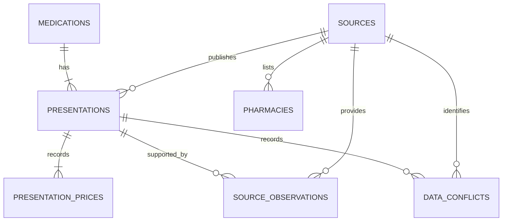

# Checkpoint 2 — relational schema proposal

Date: 2026-10-20. **Status: approved under D019; implemented and verified.**
No database has been created and no import has been run at the time of approval.
This design implements the approved storage direction; it does not replace the
finalized decision log. Verification status is tracked separately from approval.

## 1. Catalogue and source relationships (`core`)

| Table | Identity and purpose |
| --- | --- |
| `sources` | Text source identifier as primary key; AMMPS, medicament.ma, saydalia.ma. Shared by core provenance records only. |
| `medications` | Internal primary key; exact source values for brand name, active-substance text, EPI, dosage, and form. One formulation group, independent of package size. |
| `presentations` | Existing numeric-string AMMPS record ID as primary key; required medication and official-source foreign keys; original package text and presentation-level recorded metadata/provenance. |
| `presentation_prices` | Presentation foreign key plus price kind (`ppv`, `hospital`, `pfht`) as composite primary key; nullable exact MAD amount. Three rows per presentation preserve unknown prices explicitly. |
| `source_observations` | Presentation foreign key plus original list position; secondary source foreign key and original record ID, URL, fetch timestamp, raw update date, ATC, reimbursement, prices, and commercialization status. |
| `data_conflicts` | Presentation foreign key plus original list position; field, reference/observed values, source foreign key, and original source URL. |
| `medication_aliases` | Original reviewed alias spelling, normalized lookup key, canonical search term, and confirmation-required flag. Targets are search terms, which may refer to a brand or substance, rather than a single presentation. |
| `pharmacies` | Existing `saydalia:<id>` primary key; name, city, address, phone, coordinates, opening-information text, source foreign key, URLs, collection timestamp, and directory scope. |
| `import_runs` | Import identity, input paths/hashes, importer version, completion timestamp, and validated counts; written with a successful import. No patient data. |

Medication grouping uses the **exact tuple** `(brand_name, active_substance, epi,
dosage, form)`, with a uniqueness constraint and deterministic equality. No fuzzy
or normalized grouping is used. This yields **7,302 groups** for **9,936 distinct
presentations** in the current input. These groups are an internal organization of
source values, not a claim of clinical equivalence or authoritative market identity.
Strengths and forms remain distinct. Substance combination strings are preserved,
without guessing component identities or splitting ambiguous source text.

The public `Medication` object is reconstructed from the linked medication,
presentation, prices, observations, and conflicts. Every existing field has a
place: presentation metadata retains commercialization and authorization statuses,
therapeutic class, PP/GN, VAT, RCP/NAF reference, ATC, reimbursement, source page,
listing/detail URLs, and fetch time. Metadata that differs across packages stays
on presentations; it is not arbitrarily promoted to the shared medication group.

Official prices remain authoritative. Secondary observations and conflicts are
separate rows, retaining list order and original value types. A conflict's two
values may be JSONB scalars (string, number, boolean, or null); they are not forced
to text. No whole catalogue record is stored as a replacement JSON document.

Seed the existing 22 reviewed alias spellings, including confirmation-required
proposals. Normalized aliases are not individually unique: the current rules
collapse them to 17 lookup keys. Reject contradictory mappings; retain original
spellings. Keep the existing matching algorithm, form/unit rules, and pharmacy
aliases unchanged. No spelling-search extension is needed for the storage switch.

## 2. Temporary conversation tables (`core`)

| Table | Main fields and relationships |
| --- | --- |
| `conversations` | Internal ID, creation time, last successful interaction time, expiry time, and revision for concurrent updates. |
| `conversation_messages` | Internal ID, conversation foreign key, ordered sequence, role, text, timestamp, outcome, and optional versioned structured result payload for cards/sources. |
| `conversation_states` | Opaque session-token hash, conversation foreign key, version, creation time, and validated context snapshot needed to continue that turn. |
| `pending_choices` | Opaque continuation-token hash, conversation foreign key, related state/revision, and validated snapshot of offered choices/refinements and resolution state. |

Use relational ownership, ordering, timestamps, and keys, with **versioned JSONB
only for the nested conversation snapshots and rendered result structures**.
These include raw/effective interpretations, anchors, candidate IDs, scores,
refinements, and the source facts shown at that turn. They must round-trip through
explicit validation; never persist Python objects using pickle. These temporary
snapshots do not replace the relational medication catalogue.

The parent conversation controls lifetime for all its messages, session states,
and pending choices: 30 minutes since the last successful interaction. Reject
expired access even before cleanup runs. A refresh or a failed request does not
extend the lifetime. A successful clarification action does. Database time replaces
process-monotonic expiry so valid state survives restarts.

New conversation invalidates the old conversation and removes its active rows;
cleanup cascades child rows when expired conversations are deleted. Existing
unexpired conversation and clarification snapshots remain validated server-side;
arbitrary IDs or unoffered choices do not become acceptable because storage moved.
No permanent message history, accounts, or previous-chat list is introduced.

Store only hashes of bearer tokens in dedicated token columns. Transcript/result
payloads must not retain raw session or continuation secrets. Exact browser token
storage and the resume API will be specified during implementation; they must
restore the active transcript and usable context without an inference call.

Publish the successful message, resulting context, offered choices, and updated
expiry together in one transaction. Preserve user messages on failures without
advancing successful context. Database-unavailable errors still require the client
to retain the user's draft. Do not hold database row locks during hosted inference;
use revision checks to prevent concurrent turns overwriting each other. Define
request deduplication and uncertain-completion recovery before enabling persistence.

## 3. Inference state (`language`)

| Table | Purpose |
| --- | --- |
| `quota_state` | Existing scope/provider/model identity, next permitted attempt time, blocked-until time, block code, and cumulative reserved-attempt count. |
| `evaluation_budgets` | Budget ID, evaluation ID, maximum, and used count for future evaluations configured to use PostgreSQL. |
| `quota_imports` | Input-ledger identity/hash and import receipt, preventing repeated imports from resetting or double-counting state. |

Attempt reservation, applicable budget checks, and counter updates are atomic.
Cooldown updates preserve the later deadline. Never store keys, prompts, patient
messages, or responses in these tables. PostgreSQL-backed runtime and any future
live evaluation must consult the same provider/model quota scope rather than
independently bypassing each other's cooldowns.

Retain the original SQLite ledger and its historical evaluation budgets. Import
runtime counters/deadlines conservatively; repeating that import must not reduce
live counters or shorten cooldowns. Do not silently resume old evaluations or
reset their budgets after the code/storage migration. No live evaluation is part
of this checkpoint. These language-owned tables have no foreign keys into `core`.

## 4. Integrity, import, and runtime transition

- Keep public source record IDs as text; internal grouping IDs are separate.
- Use foreign keys and uniqueness constraints for ownership, prices, source
  observations, ordered messages, and tokens. Index foreign keys, expiry/cleanup
  lookups, and existing name/substance lookup needs.
- Use `NUMERIC(12,2)` for MAD price columns, with nonnegative finite values.
  Import using `Decimal(str(value))`; reject excess fractional precision rather
  than silently rounding source facts. Keep the current public response shapes
  and deterministic two-decimal totals. All inspected prices fit this type.
- Use timezone-aware timestamps for operational times. Preserve the original
  source timestamp text alongside its parsed instant where needed for exact
  provenance round-trips. PostgreSQL normalizes instants and does not preserve
  the original textual timezone spelling.
- Enforce latitude/longitude bounds and valid required text. Do not invent phone
  numbers, hours, stock, dates, duties, or structured strengths from missing text.
- Give each service runtime access only to its own schema. Use separate migration
  credentials for schema changes; avoid cross-schema joins or privileges.
- Keep service-owned Alembic migrations/version tables independent. Run migrations
  and imports explicitly. Import in a transaction with input hashes and conflict
  checks; re-importing identical inputs must not add duplicate rows. Later changed
  inputs require an explicit update policy, not an automatic destructive replace.
- Load validated relational records into the current catalogue/directory indices
  at startup initially, preserving Python matching and ranking behavior. Runtime
  facts then come from PostgreSQL, with no direct JSONL lookup or silent fallback
  when configured for PostgreSQL. Query-level search optimization can follow later.
- Keep JSONL/snapshots as import and test inputs. Offline fixture-based tests may
  retain explicit in-memory adapters; the PostgreSQL runtime is tested against
  actual PostgreSQL rather than treating SQLite as an equivalent substitute.
- Verify backup/restore into a separate database before relying on the new store.
  Original files and the checkpoint-1 implementation remain recoverable.

Acceptance checks: round-trip all 9,936 presentation records and all 327 pharmacy
records; preserve 1,126 missing public prices, 3,128 linked observations, and 1,260
conflicts; verify a repeated import, constraints/permissions, pricing/matching,
restart/resume, transcript restoration, inactivity expiry, reset, concurrent
updates, quotas, and database failure behavior. Do not rewrite frozen evidence.

Supporting data inspection: `reports/architecture_checkpoint2_data_profile.json`
records source hashes and observed counts. Raw source files were not modified.

PostgreSQL references: [exact numeric types](https://www.postgresql.org/docs/current/datatype-numeric.html),
[timestamps](https://www.postgresql.org/docs/current/datatype-datetime.html), and
[JSON types](https://www.postgresql.org/docs/16/datatype-json.html).

After schema review, resolve the driver/async approach, migration layout, and
local database setup as needed. These details and completed verification are now
recorded in `docs/architecture-checkpoint-2.md`. The user started the isolated
Docker database and controls its shutdown; the native PostgreSQL server is untouched.
