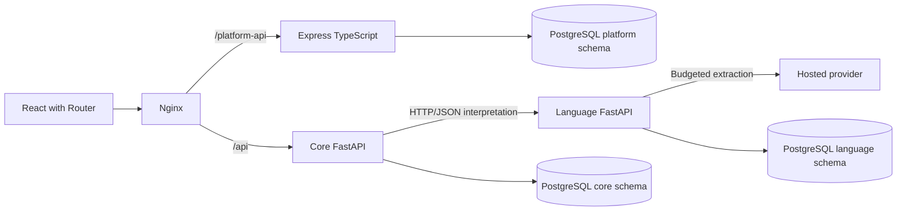

# Processing and service ownership

One French React/TypeScript application now uses React Router for the platform
introduction, accounts/profile, CSV exploration, analytics/private saved configurations
and a separate visitor-accessible `/assistant`. Nginx serves its static
assets and forwards same-origin `/api` requests to core. Core and language are
separate FastAPI services. Express/TypeScript owns accounts, PostgreSQL sessions,
guided CSV imports, immutable dataset versions and analytics through
`/platform-api`. A single PostgreSQL instance stores `platform`, `core` and
`language` with separate runtime credentials; each running service is restricted to its own schema and does not import its
peers’ implementations.

Dataset work uses owned migration `0002_datasets.sql`, parameterized full-version
queries and owner checks even for administrators. Temporary uploads expire;
successful publications atomically retain original and typed cells, configuration,
provenance and column profiles. Runtime grants prohibit mutation of published
rows/columns/versions. Migration `0003_analyses.sql` adds saved definitions/source
FKs and real analysis dependency registrations, with extended backup coverage.
Migration `0004_dashboards_sharing.sql` adds dashboards, source dependencies,
separate grants and revision-bound original-owner authorizations. The platform
never queries core/language private tables. See [dataset API](datasets-api.md).
Analytics uses parameterized server aggregations, numeric type-7 quartiles and
four visible advanced features. Configurations pin explicit source versions,
filters and algorithm settings. Every direct comparison source requires ownership
or an explicit dataset grant, even for admins; result-only queries derive from
saved configurations and cannot be replaced by a recipient. Saving creates no sharing grant. Read calculations use a repeatable-
read snapshot; saves lock active accounts/datasets and maintain dependencies
transactionally. [Analytics API and conventions](analytics-api.md).

## One question

1. The browser sends text, its temporary conversation token and a unique request
   ID to core. The token stays in tab session storage; conversation content is
   restored from the server through a read-only request.
2. Core obtains a validated interpretation from language over HTTP. Core has no
   provider SDK, in-process inference fallback or automatic HTTP retry.
3. Language reserves an attempt in PostgreSQL before contacting the configured
   provider. It applies shared spacing/cooldowns, permits only bounded eligible
   transient retries and validates schema plus source-span evidence. Provider
   errors are sanitized before crossing service boundaries.
4. Core separates extracted current-message spans from inherited context. It
   resolves medication identity, strength, form and presentation against recorded
   facts, or produces explicit clarification choices. Partial pharmacy matching
   uses the local Rabat directory. It does not scrape during a request.
5. Deterministic code calculates complete-package totals from stored prices using
   decimal rules, builds source-aware answers and saves temporary state. The
   model is not the authority for prices, pharmacy contacts or stock claims.
6. React displays the response, medication/pharmacy cards, sources and current
   choices. It formats server amounts without doing price arithmetic.

Offered choices use validated saved state and can avoid inference entirely.
Missing prices remain unknown. Ambiguous products are never silently substituted.
Provider/model selection is explicit, with no paid or automatic provider fallback.

## Temporary state and failures

PostgreSQL stores conversation state and transcript with a 30-minute inactivity
expiry. Refresh and read-only restoration never renew expiry or resend a question.
The browser never automatically repeats a POST. An uncertain result triggers a
read-only status check; pending work requires explicit verification. Failed text
remains visible with explicit retry/edit controls. Reset clears local state only
after server invalidation succeeds or the conversation has already expired.

Core's readiness checks its own storage independently of inference availability.
Language outages prevent new text interpretation but valid offered choices can
remain usable. Missing/unavailable PostgreSQL fails startup/readiness clearly;
neither service selects a file or SQLite fallback. Temporary memory resources
are available only through explicit offline tooling/test injection.

## Code boundaries

Core owns `api/`, `conversation/`, `medications/`, `pharmacies/`, `clients/` and
`storage/postgres/`. Language owns `api/`, `extraction/`, `providers/`, `quota/`
and `storage/postgres/`. Each service owns its settings, tables, migration history,
dependency manifest, image and tests.

`pharmacy-contracts` contains schemas, protocols and errors. Shared infrastructure
contains environment/connection/path helpers and read-only archive resolution;
it owns no business rules or tables. Maintenance and evaluation packages may
depend explicitly on both services, but services do not depend on those tools.

The virtual uv root coordinates six installable members and one lockfile. The
five normal containers are web, platform, core, language and PostgreSQL. The operations
image runs only explicit setup jobs. Only web is exposed by default; phone/debug
overlays are explicit opt-ins. See [setup](../operations/setup.md),
[administration](../operations/tooling.md), [evaluation](../development/evaluation-tools.md)
and [architecture-phase decisions](../development/decisions-2026-10-19-20.md).
The [current decision tracker](../../DECISION_LOG.md) separates approved Full Stack
CdC decisions from actual implementation. Accounts/navigation and Checkpoint 2
CSV datasets/exploration plus Checkpoint 3 analytics are implemented in the
workspace. Checkpoint 4 dashboard/collaboration host checks and the final
production gate pass, including the frontend source-switch mapping fix.
Administration remains future work. See the
[account API](platform-api.md), [dataset API](datasets-api.md),
[analytics API](analytics-api.md), [dashboard/sharing API](dashboards-sharing-api.md),
[explicit upgrade](../operations/dashboards-sharing.md) and
[Checkpoint 4 evidence/limits](../validation/platform-checkpoint-4.md).
