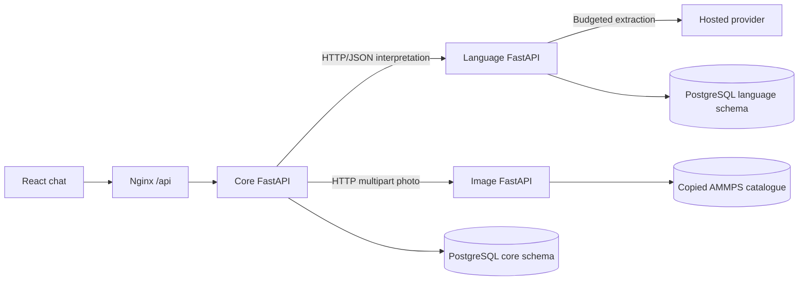

# Processing and service ownership

The patient interface is a French React/TypeScript chat. Nginx serves its static
assets and forwards same-origin `/api` requests to core. Core and language are
separate FastAPI services. A standalone image service performs local OCR and
fuzzy matching for uploaded medication photos. A single PostgreSQL instance
stores the core and language schemas with separate credentials; neither running
service accesses the other's tables or imports its implementation.

## One question

1. The browser sends text, its temporary conversation token and a unique request
   ID to core. The token stays in tab session storage; conversation content is
   restored from the server through a read-only request.
2. Core obtains a validated interpretation from language over HTTP. Core has no
   provider SDK, in-process inference fallback or automatic HTTP retry.
3. Language reserves an attempt in PostgreSQL before contacting the configured
   provider. It applies shared spacing/cooldowns, permits only bounded eligible
   transient retries and validates schema plus source-span evidence. Provider
   errors are sanitized before crossing service boundaries.
4. Core separates extracted current-message spans from inherited context. It
   resolves medication identity, strength, form and presentation against recorded
   facts, or produces explicit clarification choices. Partial pharmacy matching
   uses the local Rabat directory. It does not scrape during a request.
5. Deterministic code calculates complete-package totals from stored prices using
   decimal rules, builds source-aware answers and saves temporary state. The
   model is not the authority for prices, pharmacy contacts or stock claims.
6. React displays the response, medication/pharmacy cards, sources and current
   choices. It formats server amounts without doing price arithmetic.

A photo turn follows the same temporary-conversation flow. Core validates the
multipart image and calls the image service. That service runs EasyOCR and
field-aware RapidFuzz matching against its copied AMMPS catalogue, then returns
the recognized text and ranked source IDs. Core maps those IDs to its own loaded
records, builds the normal answer/cards response with `provider: "local"`, and
saves the session so a typed follow-up can inherit the candidate. OCR never
invents a catalogue fact; empty or unmatched text is reported explicitly.

Offered choices use validated saved state and can avoid inference entirely.
Missing prices remain unknown. Ambiguous products are never silently substituted.
Provider/model selection is explicit, with no paid or automatic provider fallback.

## Temporary state and failures

PostgreSQL stores conversation state and transcript with a 30-minute inactivity
expiry. Refresh and read-only restoration never renew expiry or resend a question.
The browser never automatically repeats a POST. An uncertain result triggers a
read-only status check; pending work requires explicit verification. Failed text
remains visible with explicit retry/edit controls. Reset clears local state only
after server invalidation succeeds or the conversation has already expired.

Core's readiness checks its own storage independently of inference availability.
Language outages prevent new text interpretation but valid offered choices can
remain usable. Missing/unavailable PostgreSQL fails startup/readiness clearly;
neither service selects a file or SQLite fallback. Temporary memory resources
are available only through explicit offline tooling/test injection.

## Code boundaries

Core owns `api/`, `conversation/`, `medications/`, `pharmacies/`, `clients/` and
`storage/postgres/`. Language owns `api/`, `extraction/`, `providers/`, `quota/`
and `storage/postgres/`. Image owns `medid/` (API, OCR, matching, catalogue and
pipeline). Each service owns its settings, dependency manifest, image and tests;
the image service has no database or conversation state.

`pharmacy-contracts` contains schemas, protocols and errors. Shared infrastructure
contains environment/connection/path helpers and read-only archive resolution;
it owns no business rules or tables. Maintenance and evaluation packages may
depend explicitly on both services, but services do not depend on those tools.

The virtual uv root coordinates six installable members and one lockfile. The
image service is standalone (own `requirements.txt` and container) so EasyOCR and
PyTorch do not burden every Python install. The five normal containers are web,
core, language, image and PostgreSQL. The operations image runs only explicit
setup jobs. Only web is exposed by default; phone/debug overlays are explicit
opt-ins. See [setup](../operations/setup.md),
[administration](../operations/tooling.md), [evaluation](../development/evaluation-tools.md)
and [finalized decisions](../../DECISION_LOG.md).
